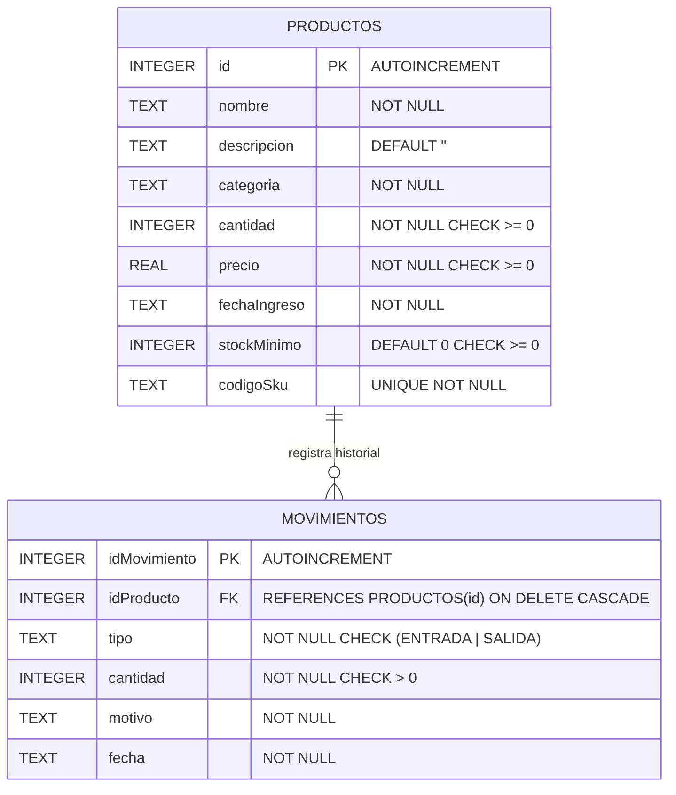

# 📦 Inventario · Sistema Móvil y Multiplataforma de Gestión de Stock (TCC)

[](https://flutter.dev)
[](https://dart.dev)
[](https://sqlite.org)
[](https://pub.dev/packages/provider)
[-success)](test/models_and_transactions_test.dart)
[](docs/Informe_Final_Actividad_TCC.docx)
[](#-guía-de-instalación-y-ejecución)

> **Solución móvil y multiplataforma *Offline-First*** para el control de inventarios comerciales, desarrollada en **Flutter** con persistencia relacional local en **SQLite**, arquitectura desacoplada por capas (**Clean Architecture**), gestión reactiva de estado con **Provider**, transacciones seguras **ACID** para entradas/salidas de mercancía y sistema de diseño **Material Design 3**.

---

## 🎓 Información Académica e Institucional

* **Asignatura:** Desarrollo de Aplicaciones Móviles
* **Actividad:** Trabajo Colaborativo Contextualizado (TCC) · Unidad 4
* **Programa Académico:** Ingeniería de Software — V Semestre
* **Equipo de Trabajo (CIPA):**
  * **Jezer Martínez Pérez**
  * **Mariana Camila Olmos Pérez**
  * **Jesús David Guerrero Rada**
* **Tutor Docente:** **Elkin José Navarro Osorio**
* **Entregable Formal en Word:** [`docs/Informe_Final_Actividad_TCC.docx`](docs/Informe_Final_Actividad_TCC.docx) (22 páginas, estructurado bajo **Normas APA 7ª edición**, con tabla de contenido, árbol modular y 9 evidencias visuales integradas).

---

## 📌 Contexto del Negocio y Problemática

Los pequeños comercios, bodegas y negocios de retail enfrentan con frecuencia caídas de conectividad y pérdidas de tiempo al gestionar existencias en hojas de cálculo o cuadernos manuales. 

La aplicación **Inventario** resuelve esta necesidad crítica mediante una arquitectura **100% autónoma (*Offline-First*)**:
1. **Disponibilidad Permanente:** Todo el motor de datos opera en un archivo local SQLite (`inventario_tcc.db`), sin depender de internet ni de servidores externos.
2. **Cero Inconsistencias (Transacciones ACID):** Las salidas de almacén validan estrictamente que la cantidad requerida no sobregire el stock disponible; la actualización de existencias y el registro en el histórico se ejecutan como una unidad atómica indivisible.
3. **Control Financiero Instantáneo:** Valorización automática del catálogo en moneda local ($ COP) y detección temprana de productos agotados o bajo el umbral mínimo.

---

## ✨ Características y Módulos Principales

| Módulo | Descripción Funcional |
| :--- | :--- |
| **📊 Dashboard Analítico (KPIs)** | Banner ejecutivo superior con saludo dinámico y fecha actual. Tarjetas métricas en tiempo real: **Total de Productos**, **Unidades Físicas en Stock**, **Valorización Financiera Total ($ COP)** y **Productos en Stock Crítico**. Banner de alerta temprana para desabastecimiento. |
| **🔍 Catálogo Inteligente** | Búsqueda reactiva con *debounce* (por nombre o código SKU), segmentación rápida por chips de categoría con conteo dinámico, y filtro directo para existencias críticas. |
| **🚦 Semáforo Visual de Existencias** | Badges cromáticos informativos: **Stock Óptimo** (verde esmeralda), **Stock Moderado** (amarillo ámbar), **Stock Crítico** (rojo carmesí) y **Agotado**. |
| **⚡ Registro Rápido Transaccional** | Modal ergonómico (`MovementDialog`) para asentar **Entradas** (compras, ajustes) y **Salidas** (ventas, mermas), con previsualización en vivo del saldo resultante y bloqueo estricto si no hay stock suficiente. |
| **📝 Formulario y Ficha Técnica** | Creación y edición completa de productos con validaciones de formulario, autocompletado de categorías, código SKU y animación de transición **Hero** hacia la vista detallada. |
| **📜 Historial Cronológico** | Trazabilidad detallada de todos los movimientos de almacén, filtros por tipo de operación (Entrada/Salida/Todos) y rangos de fecha, con cálculo del balance neto. |
| **🌐 Soporte Híbrido (Web + Móvil)** | Capacidad de ejecutarse tanto de forma nativa en **Android** como en **Navegadores Web** (Chrome/Edge) mediante la capa FFI Web de SQLite (`sqflite_common_ffi_web`). |

---

## 🏛️ Arquitectura Técnica de Software

La aplicación implementa una **Arquitectura en Capas Desacopladas (*Clean Layered Architecture*)**, garantizando separación de responsabilidades, alta cohesión y testeabilidad total:

```
┌─────────────────────────────────────────────────────────────┐
│                 PRESENTATION LAYER (UI)                     │
│  MainNavigationScreen · Dashboard · Catalog · History · Form│
│  Custom Widgets: KpiCard · ProductCard · MovementDialog     │
└──────────────────────────────▲──────────────────────────────┘
                               │ Escucha reactiva (Consumer / Watch)
┌──────────────────────────────┴──────────────────────────────┐
│                    STATE / PROVIDER LAYER                   │
│        InventoryProvider (extends ChangeNotifier)           │
│  Búsqueda con debounce · Filtros reactivos · Notificaciones │
└──────────────────────────────▲──────────────────────────────┘
                               │ Delegación de Casos de Uso
┌──────────────────────────────┴──────────────────────────────┐
│                      REPOSITORY LAYER                       │
│    IInventoryRepository (Contrato) · InventoryRepository    │
└──────────────────────────────▲──────────────────────────────┘
                               │ Operaciones CRUD y db.transaction()
┌──────────────────────────────┴──────────────────────────────┐
│                      DATA LAYER (SQLite)                    │
│    DatabaseHelper (Singleton) · Índices · FKs en Cascada    │
│    Modelos DTO: ProductModel · MovementModel · Summary      │
└─────────────────────────────────────────────────────────────┘
```

---

## 🗄️ Esquema de Base de Datos Relacional (SQLite)

### Diagrama Entidad–Relación



### Definición DDL (Data Definition Language)

```sql
PRAGMA foreign_keys = ON;

-- Tabla de Catálogo de Productos
CREATE TABLE productos (
  id INTEGER PRIMARY KEY AUTOINCREMENT,
  nombre TEXT NOT NULL,
  descripcion TEXT NOT NULL DEFAULT '',
  categoria TEXT NOT NULL,
  cantidad INTEGER NOT NULL CHECK (cantidad >= 0),
  precio REAL NOT NULL CHECK (precio >= 0),
  fechaIngreso TEXT NOT NULL,
  stockMinimo INTEGER NOT NULL DEFAULT 0 CHECK (stockMinimo >= 0),
  codigoSku TEXT NOT NULL UNIQUE
);

CREATE INDEX idx_productos_nombre ON productos(nombre);
CREATE INDEX idx_productos_categoria ON productos(categoria);

-- Tabla de Trazabilidad de Movimientos
CREATE TABLE movimientos (
  idMovimiento INTEGER PRIMARY KEY AUTOINCREMENT,
  idProducto INTEGER NOT NULL,
  tipo TEXT NOT NULL CHECK (tipo IN ('ENTRADA', 'SALIDA')),
  cantidad INTEGER NOT NULL CHECK (cantidad > 0),
  motivo TEXT NOT NULL,
  fecha TEXT NOT NULL,
  FOREIGN KEY (idProducto) REFERENCES productos(id) ON DELETE CASCADE
);

CREATE INDEX idx_movimientos_producto ON movimientos(idProducto);
CREATE INDEX idx_movimientos_fecha ON movimientos(fecha DESC);
```

---

## 📸 Evidencias Visuales de la Aplicación

Todas las capturas fueron tomadas en tiempo real sobre el emulador Android **Android 17 / API 37** (`emulator-5554`) en resolución nativa de **1344 × 2992 px**:

| Captura | Vista / Flujo | Descripción |
| :---: | :--- | :--- |
|  | **Dashboard KPIs** | Saludo dinámico, métricas analíticas en tiempo real y accesos rápidos. |
|  | **Catálogo con Filtros** | Buscador con debounce, chips de categorías y semáforo visual de stock. |
|  | **Alta de Producto** | Validación reactiva de campos, asignación de SKU y categoría. |
|  | **Modal de Entrada** | Adición de stock con cálculo previo del nuevo saldo disponible. |
|  | **Modal de Salida** | Descuento de stock con bloqueo automático si supera existencias. |
|  | **Historial y Trazabilidad** | Balance neto, filtros cronológicos y tarjetas de movimiento tipadas. |
|  | **Ficha Técnica Hero** | Detalle completo del producto y animación Hero desde la tarjeta. |
|  | **Confirmación Entrada** | Feedback táctil y Snackbar flotante tras asentar entrada. |
|  | **Confirmación Salida** | Feedback contextual y recarga instantánea del inventario. |

---

## 🧪 Pruebas Automatizadas y Aseguramiento de Calidad

El proyecto incluye una suite exhaustiva de pruebas unitarias y de integración sobre **SQLite in-memory FFI** ubicada en [`test/models_and_transactions_test.dart`](test/models_and_transactions_test.dart):

```bash
flutter test
```

### Resultados de la Auditoría (6/6 Tests Aprobados · 100% Éxito):
1. `ProductModel serializes and restores every field`: Serialización bidireccional (`toMap` / `fromMap`).
2. `MovementModel round-trips both movement type and optional values`: Validación de tipos tipados (`ENTRADA`/`SALIDA`).
3. `InventorySummaryModel defaults missing aggregate values to zero`: Tolerancia a valores nulos o agregaciones vacías.
4. `inventory summary calculates count, units, value and critical stock`: Correctitud matemática de las métricas agregadas del dashboard.
5. `movement transactions update stock and rollback invalid exits`: Verificación de aislamiento **ACID** (actualización atómica y reversión inmediata si la salida supera el saldo).
6. `movement rejects zero quantity and unknown products without writes`: Rechazo preventivo de operaciones inválidas sin escrituras huérfanas en disco.

---

## 🚀 Guía de Instalación y Ejecución

### Requisitos Previos
* [Flutter SDK](https://flutter.dev) (versión 3.20.0 o superior).
* [Google Chrome](https://www.google.com/chrome/) o [Microsoft Edge] (para ejecución Web) o Android Studio con emulador Android configurado.

### ⚡ Modo Rápido (Recomendado para Windows)
Simplemente haz **doble clic** sobre el script batch incluido en la raíz:

```cmd
iniciar_servidor.bat
```
*(Opcionalmente presiona `Enter` para iniciar directamente en tu navegador web en `http://localhost:8080`).*

### Modo Consola / CLI

```bash
# 1. Clonar el repositorio
git clone https://github.com/Jezeriom/tcc_app_fifth.git
cd tcc_app_fifth/tcc_app

# 2. Obtener dependencias
flutter pub get

# 3. Ejecutar en Navegador Web (Chrome)
flutter run -d chrome --web-port 8080

# 4. O ejecutar como Servidor Web Local
flutter run -d web-server --web-port 8080 --web-hostname 0.0.0.0

# 5. O ejecutar en Emulador Android conectado
flutter run -d emulator-5554

# 6. Ejecutar suite de pruebas unitarias
flutter test
```

---

## 📂 Estructura del Repositorio

```text
tcc_app/
├── android/                         # Configuración nativa Android y launcher icons
├── assets/
│   └── launcher/                    # Iconos vectoriales y adaptativos de la aplicación
├── docs/                            # Entregables académicos oficiales
│   ├── screenshots/                 # Banco de 9 capturas en alta definición (1344x2992)
│   └── Informe_Final_Actividad_TCC.docx # Informe formal (22 páginas, APA 7)
├── lib/                             # Código fuente de la solución Flutter
│   ├── core/                        # Núcleo y servicios compartidos
│   │   ├── constants/               # Paleta ejecutiva y tema Material 3
│   │   ├── database/                # DatabaseHelper SQLite (Singleton, DDL, transacciones)
│   │   └── utils/                   # Formato contable y validaciones
│   ├── models/                      # Entidades de dominio (Product, Movement, Summary)
│   ├── providers/                   # Estado reactivo global (InventoryProvider)
│   ├── repositories/                # Contrato e implementación de acceso a datos
│   ├── views/                       # Pantallas y componentes gráficos
│   │   ├── dashboard/               # Resumen analítico y KPIs
│   │   ├── history/                 # Historial cronológico y balance neto
│   │   ├── inventory/               # Catálogo, formularios y modales
│   │   └── main_navigation_screen.dart # Barra de navegación Material 3
│   └── main.dart                    # Punto de entrada y configuración MultiProvider
├── test/
│   └── models_and_transactions_test.dart # Suite de pruebas automatizadas (6/6 aprobadas)
├── iniciar_servidor.bat             # Script de lanzamiento con menú interactivo
├── iniciar_app.bat                  # Acceso directo al lanzador
├── pubspec.yaml                     # Dependencias del proyecto
└── README.md                        # Esta documentación
```

---

## 👥 Créditos y Autores (CIPA)

* **Jezer Martínez Pérez**
* **Mariana Camila Olmos Pérez**
* **Jesús David Guerrero Rada**

*Docente Asignado:* **Elkin José Navarro Osorio**  
*Universidad de Cartagena — Ingeniería de Software*  
*Octubre – Noviembre 2026*
